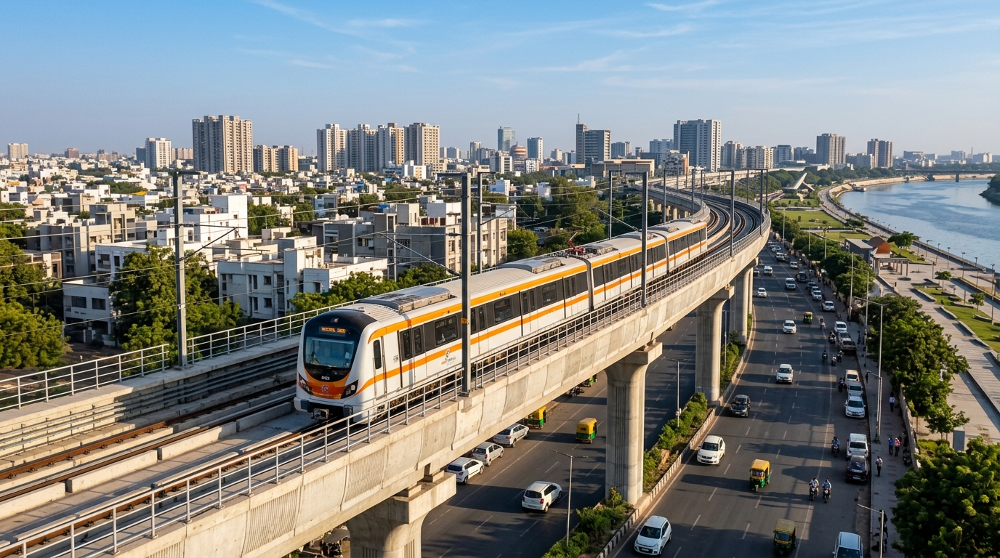
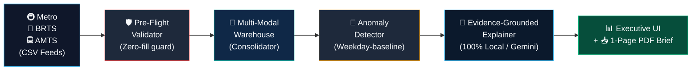

<div align="center">

# 🚇 TransitPulse AI
### AI-Powered Public Transport Operations Intelligence & Two-Minute Morning Brief

[](https://python.org)
[](https://streamlit.io)
[](https://gdg.community.dev)
[](tests/test_pipeline.py)
[](#-100-offline--air-gap-resilience)
[](LICENSE)

<br/>

> **"Transforms fragmented daily Metro, BRTS, and AMTS operational CSV feeds into an evidence-backed, 1-page executive morning brief in under 120 seconds."**

<br/>

<!-- Real-Time Animated Metro Transit Simulation -->
<a href="#-quick-demo-walkthrough-2-minute-judge-flow">
  
</a>

</div>

<br/>

<div align="center">
  
</div>

---

## 📌 The Problem vs. The Solution

Public transit authorities spend **3+ hours every morning** manually reconciling disparate CSV spreadsheets across Metro, BRTS, and municipal buses—often missing route drop-offs and delay spikes.

| Capability | Traditional Spreadsheets | TransitPulse AI Solution |
| :--- | :--- | :--- |
| **Ingestion Speed** | 2–3 hours manual VLOOKUP | **< 2 seconds** across Metro, BRTS & AMTS |
| **Data Quality Gate** | Silent zeros & corrupted dates skew charts | **Pre-Flight Schema Audit** with actionable repair hints |
| **Baseline Strategy** | Flat 7-day average (weekend skew) | **Weekday-Adjusted Baselines** (Mondays vs. Mondays) |
| **Root-Cause Analysis**| Subjective guesswork | **Evidence-Backed Hypotheses** separated from telemetry facts |
| **Executive Output** | 30-slide bloated deck prepared by noon | **1-Page Vector PDF Standup Brief** ready before 07:35 AM |
| **Data Security** | Cloud upload exposure | **100% Air-Gapped & Offline Capable** |

<br/>

<div align="center">
  
  <p><em>Ahmedabad Metro (GMRC) Elevated Viaduct Network over Ahmedabad & Sabarmati Riverfront</em></p>
</div>

---

## ⏱️ Quick Demo Walkthrough (2-Minute Judge Flow)

| Step | Time | Action in App | What to Notice |
| :---: | :---: | :--- | :--- |
| **1** | **0:00 – 0:30** | Click **"🧪 Test Validation Failure"** | Pre-flight audit traps negative ridership, bad dates, and duplicates with clear fix suggestions. |
| **2** | **0:30 – 1:00** | Click **"🚨 Load Incidents"** | Consolidates 14 days of multi-modal data for Ahmedabad & Gandhinagar in **1.2s**. |
| **3** | **1:00 – 1:30** | Open **"🔍 Operations Intelligence"** | Inspect 3 injected incidents ranked by statistical deviation:<br/>• **Metro East-West Line:** Delays spiked +1,080% (signaling fault).<br/>• **BRTS Route 303:** Ridership dropped -38.2% (road diversion).<br/>• **AMTS Route 151:** Availability dropped to 76.1% (depot shortage). |
| **4** | **1:30 – 2:00** | Open **"📋 Two-Minute Daily Brief"** & click **"📥 Download 1-Page PDF"** | Generates an executive standup PDF (ReportLab) with Health Score (74/100) and priority actions. |

---

## 🏗️ System Architecture



---

## 🛠️ Tech Stack & Highlights

* **Language & Runtime:** Python 3.10+
* **Frontend & Landing Portal:** Streamlit *(White & Ahmedabad Metro Orange `#FF6B00` UI with Realistic Viaduct Hero)*
* **Data & Analytics:** Pandas & NumPy *(Pre-flight validation, multi-modal consolidation, weekday baselines)*
* **Visualizations:** Plotly *(Ridership trends, availability gauges, delay waterfalls)*
* **PDF Briefing Engine:** ReportLab 4.x *(Direct in-memory 1-page vector PDF compiler)*
* **AI & Explanations:**
  * **Primary (100% Offline):** Built-in deterministic transit rule engine *(Facts vs. hypotheses separation)*
  * **Optional:** Google Gemini API (`google-genai`) *(Natural language brief synthesis)*
* **Automated Tests:** Python `unittest` *(100% passing)*

### 🔒 100% Offline / Air-Gap Resilience
Built for mission-critical transit control rooms. The entire validation, anomaly detection, statistical baselining, and PDF generation pipeline runs completely locally with **zero internet connection and zero cloud dependencies**.

---

## ⚡ Quickstart Guide

```bash
# 1. Clone repository
git clone https://github.com/anushkayerpude/TransitPulseAI.git
cd TransitPulseAI

# 2. Setup virtual environment & dependencies
python3 -m venv .venv
source .venv/bin/activate       # On Windows: .venv\Scripts\activate
pip install -r requirements.txt

# 3. Run test suite
python -m unittest tests/test_pipeline.py

# 4. Launch application
streamlit run app.py
```
Open **`http://localhost:8501`** in your browser.

---

<div align="center">
  
  <br/><br/>
  <sub>Developed by <b>Anushka Yerpude</b> for <b>DevFest Gandhinagar — Metro Hacks (PS-13)</b> • Licensed under <a href="LICENSE">MIT</a></sub>
</div>
