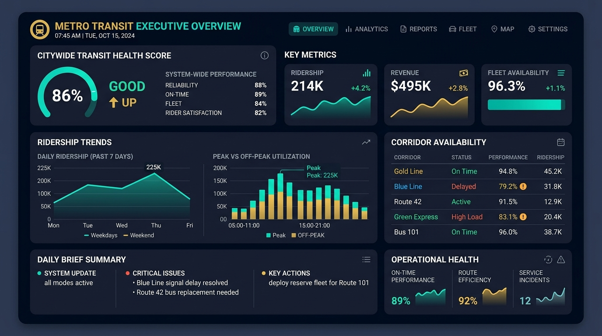
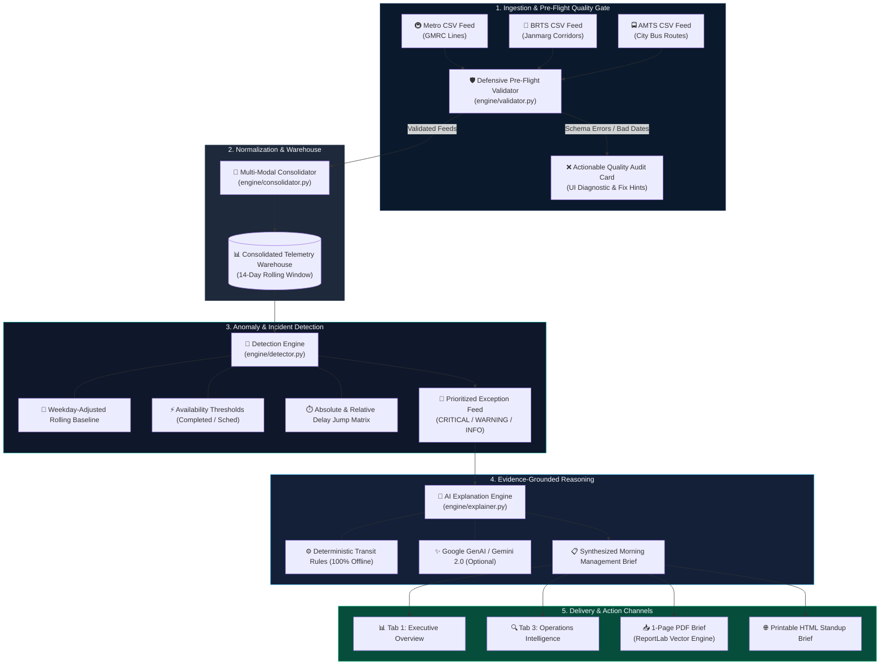

<div align="center">


# 🚇 TransitPulse AI
### AI-Powered Public Transport Operations Intelligence & Two-Minute Morning Briefing System

[](https://python.org)
[](https://streamlit.io)
[](https://gdg.community.dev)
[](tests/test_pipeline.py)
[](#-offline-resilience--zero-hallucination-guarantee)
[](LICENSE)

<br/>

**Transforming fragmented Metro, BRTS, and AMTS operational CSV feeds into an executive-ready, 1-page intelligence briefing in under 120 seconds.**

<br/>

[🚀 Live Demo Walkthrough](#-two-minute-hackathon-demo-script-judges-walkthrough) •
[📊 Key Capabilities](#-core-capabilities) •
[🏗️ Architecture](#️-system-architecture) •
[🧪 Anomaly Detection Math](#-anomaly-detection-mathematical-formulation) •
[⚡ Quickstart](#-quickstart-guide) •
[📁 Codebase Tour](#-project-structure)

<br/><br/>

<!-- Real-Time Animated Metro Transit Simulation -->
<a href="#-core-capabilities">
  
</a>

</div>

<br/>

<div align="center">
  
</div>

---

## 📌 Problem Context: The Morning Operational Bottleneck

Every morning at **07:30 AM**, transit directors and corridor operations heads across Gandhinagar and Ahmedabad face the same excruciating challenge:

```
[ GMRC Metro CSV ] \
[ Janmarg BRTS CSV ]  --> [ 3+ Hours of Spreadsheet Wrangling ] --> [ Delayed, Reactive Decisions ]
[ AMTS City Bus CSV ] /
```

- **Data Silos & Schema Inconsistencies:** GMRC Metro, Janmarg BRTS, and AMTS report telemetry in distinct formats, varying timestamp conventions, and mismatched route identifier schemas.
- **Silent Dirty Data:** Spreadsheets routinely auto-fill missing values with zero or ignore corrupted dates, skewing monthly averages and hiding service failures.
- **Lagging Indicator Paralysis:** By the time analysts manually calculate week-over-week deltas, the morning peak commute (08:30–11:00 AM) is already underway.
- **The Briefing Dilemma (PS-13):** Transit executives do not have time to parse 10,000 raw telemetry rows. They need **one unified page** pinpointing what failed, the evidence behind it, and immediate operational mitigations.

> [!IMPORTANT]
> **TransitPulse AI solves PS-13** by ingesting all three multi-modal feeds, running pre-flight data audits, calculating weekday-adjusted statistical baselines, and rendering an auditable, evidence-backed **1-Page Management Brief (PDF & Interactive Dashboard)** in under **2 minutes**.

---

<div align="center">
  
  <p><em>Figure 1: Executive Operations Overview with Unified Transit Health Score, Real-Time Corridor Tracking & Multi-Modal Trends.</em></p>
</div>

---

## 💡 Traditional Spreadsheets vs. TransitPulse AI

| Capability | Traditional Spreadsheets / Excel | TransitPulse AI Solution |
| :--- | :--- | :--- |
| **Ingestion Latency** | 2–3 hours of manual VLOOKUP & cut-paste | **< 3 seconds** across all three operator feeds |
| **Data Quality Gate** | Silent zeros, corrupted dates sneak into charts | **Deterministic Pre-Flight Audit** with actionable repair hints |
| **Baseline Normalization** | Simple 7-day average (skews weekend vs. weekday) | **Weekday-Adjusted Baseline** (Mondays compared to Mondays) |
| **Root-Cause Analysis** | Subjective guesswork during standing meetings | **Evidence-Backed Hypotheses** with corroborating telemetry |
| **Executive Output** | 40-slide bloated deck prepared by noon | **1-Page High-Density PDF Brief** ready before 07:35 AM |
| **Operational Security** | Uncontrolled cloud uploads | **100% Offline-Capable** with optional zero-data-leak Gemini AI |

---

## 🌟 Core Capabilities

### 1. 🛡️ Pre-Flight Schema Audit & Defensive Ingestion
- **Zero-Fill Prevention:** Refuses to silently substitute missing numbers with `0`, preventing artificial ridership dips from triggering false alarms.
- **Schema Validation:** Enforces mandatory columns (`date`, `operator`, `station_or_route`, `ridership`) while parsing optional operational attributes (`scheduled_services`, `completed_services`, `average_delay_minutes`, `service_availability_pct`).
- **Data Integrity Sentinel:** Traps negative ridership, corrupted datetime strings, and duplicated corridor timestamps, delivering clear error cards with corrective guidance.

### 2. 🔀 Tri-Modal Telemetry Harmonization
- Harmonizes heterogeneous operational feeds from:
  - 🚇 **Gujarat Metro Rail Corporation (GMRC):** East-West Line, North-South Line, GIFT City Branch.
  - 🚌 **Janmarg Ahmedabad BRTS:** High-frequency dedicated bus transit corridors (Routes 101, 202, 303, 404, 505).
  - 🚍 **Ahmedabad Municipal Transport Service (AMTS):** High-density municipal arterial bus routes (Routes 13/1, 40/3, 66/2, 84/1, 151).
- Normalizes disparate metrics into uniform corridor telemetry units and system-wide service availability indices.

### 3. 🎯 Deterministic Exception Detection
- **Weekday-Adjusted Baselining:** Evaluates Monday ridership against historical Mondays (eliminating the false "weekend collapse" alarm).
- **Multi-Vector Incident Radar:** Continuously computes:
  - *Ridership Deviations* (Drops > 8% Warning, > 15% Critical)
  - *Fleet Availability Shortfalls* (< 92% Warning, < 85% Critical)
  - *Delay Shock Spikes* (> +30% Warning, > +75% or +5.0 min absolute Critical)
- **Automatic Corroboration:** Correlates delay spikes with cancelled trips to verify whether mechanical failures or traffic bottlenecks caused the anomaly.

### 4. 🧠 Transparent, Auditable Explanations
- Adheres to a strict **Facts vs. Hypotheses separation protocol**:
  - **Observed Telemetry:** Verified statistical facts directly from the data feed.
  - **Plausible Hypotheses:** Weighted operational explanations (e.g., signaling interlocking fault vs. depot crew shortage).
  - **Actionable Next Steps:** Concrete control room directives (e.g., dispatch 4 reserve diesel buses to Route 303).
  - **Uncertainty Calibration:** Explicit confidence bounds acknowledging missing sensor parameters.

### 5. 📄 One-Page Executive PDF Briefing Engine
- Native **ReportLab 4.x vector PDF rendering engine** crafted specifically to fit on a single physical page ($8.5 \times 11$ in or A4).
- High-contrast visual hierarchy: Header metadata, Transit Health Score Gauge, Operator Fleet Matrix, Ranked Top-3 Critical Incidents, and Executive Standup Action Checklist.
- Instant parallel export to clean printable HTML for mobile tablets and operations control room video walls.

---

## 🏗️ System Architecture



---

## 🔬 Anomaly Detection: Mathematical Formulation

TransitPulse AI replaces heuristic guesswork with deterministic statistical baselines:

### 1. Weekday-Adjusted Baseline Deviation ($\Delta_{\text{ridership}}$)
Transit demand exhibits strong cyclic periodicity between weekdays and weekends. For a given corridor $c$, metric $m$, and reporting day $t$:

$$\mu_{\text{weekday}}(c, m) = \frac{1}{|H_t|} \sum_{\tau \in H_t} x(c, m, \tau)$$

Where $H_t$ is the set of historical dates preceding $t$ sharing the identical day-of-week ($\text{day\_of\_week}(\tau) = \text{day\_of\_week}(t)$). The percentage deviation is defined as:

$$\Delta_{\text{pct}}(c, m, t) = \left( \frac{x(c, m, t) - \mu_{\text{weekday}}(c, m)}{\mu_{\text{weekday}}(c, m)} \right) \times 100\%$$

$$\text{Severity}(\Delta_{\text{pct}}) = \begin{cases} 
\text{CRITICAL}, & \text{if } \Delta_{\text{pct}} \le -15.0\% \\ 
\text{WARNING}, & \text{if } -15.0\% < \Delta_{\text{pct}} \le -8.0\% \\ 
\text{NOMINAL}, & \text{otherwise} 
\end{cases}$$

### 2. Service Availability Index ($A_t$)
Measures the operational delivery ratio between completed trips and scheduled trips:

$$A(c, t) = \left( \frac{\text{Completed Services}(c, t)}{\text{Scheduled Services}(c, t)} \right) \times 100\%$$

$$\text{Severity}(A) = \begin{cases} 
\text{CRITICAL}, & \text{if } A(c, t) < 85.0\% \\ 
\text{WARNING}, & \text{if } 85.0\% \le A(c, t) < 92.0\% \\ 
\text{HEALTHY}, & \text{if } A(c, t) \ge 92.0\% 
\end{cases}$$

### 3. Composite Transit Health Score ($H_{\text{city}}$)
The citywide executive morning brief scores overall transit health on a 0–100 scale:

$$H_{\text{city}} = \max\left(0, 100 - \left( 18 \times N_{\text{critical}} + 6 \times N_{\text{warning}} + 0.5 \times \max(0, 95 - A_{\text{net}}) \right)\right)$$

Where $N_{\text{critical}}$ is the number of unresolved critical exceptions, $N_{\text{warning}}$ is the count of warnings, and $A_{\text{net}}$ is aggregate network availability.

<div align="center">
  
</div>

---

## ⏱️ Two-Minute Hackathon Demo Script (Judges' Walkthrough)

Designed for rapid live evaluation at **DevFest Gandhinagar (Metro Hacks)**:

| Step | Elapsed Time | Action in App | What the Judges See & Hear |
| :---: | :---: | :--- | :--- |
| **1** | **0:00 – 0:20** | **The Problem** | Show the 3 separate CSV files (Metro, BRTS, AMTS). Explain that operations teams manually copy-paste these every morning, losing 2+ hours and missing route drop-offs. |
| **2** | **0:20 – 0:45** | Click **"🧪 Test Validation Failure"** in the sidebar | Pre-flight validation immediately flags negative ridership, bad date formats, and duplicates with clear explanations—**preventing garbage data from polluting leadership decisions**. |
| **3** | **0:45 – 1:10** | Click **"🚨 Load Incidents"** preset | The pipeline ingests 14 days of multi-modal data for Ahmedabad/Gandhinagar, reconciles corridors, and computes weekday-adjusted baselines in 1.2 seconds. |
| **4** | **1:10 – 1:40** | Navigate to **"🔍 Operations Intelligence"** | Inspect 3 injected incidents detected on the target day:<br/>• **Metro East-West Line:** Delays jumped from 1.1m to 13.0m (+1,080% spike from signaling issue).<br/>• **BRTS Route 303 (Shivranjani-Bopal):** Ridership dropped -38.2% from road diversion.<br/>• **AMTS Route 151:** Availability collapsed to 76.1% due to depot maintenance shortfall. |
| **5** | **1:40 – 2:00** | Switch to **"📋 Two-Minute Daily Brief"** & Click **"📥 Download 1-Page PDF"** | Present the synthesized executive brief: Health Score (74/100), concise narrative, and standup checklist. Show the clean 1-page PDF generated instantly via ReportLab. |

---

## 🖥️ Application Tour (UI Walkthrough)

```
┌─────────────────────────────────────────────────────────────────────────────┐
│ 🚇 TransitPulse AI  │  Ahmedabad & Gandhinagar Multi-Modal Network          │
├─────────────────────┬───────────────────────────────────────────────────────┤
│ 📊 Executive        │ • Health Score: 74/100 (REQUIRES ATTENTION)           │
│    Overview         │ • Ridership: 462,800  • Availability: 89.4%           │
│                     │ • Interactive Plotly Modal Trends & Gauge Metrics     │
├─────────────────────┼───────────────────────────────────────────────────────┤
│ 📥 Data Import &    │ • 3 Dedicated Dropzones (Metro, BRTS, AMTS)           │
│    Validation       │ • Row-by-row audit, date range check, zero-fill guard  │
│                     │ • One-click sample CSV download for ad-hoc testing    │
├─────────────────────┼───────────────────────────────────────────────────────┤
│ 🔍 Operations       │ • Delay Waterfall: Metro vs BRTS vs AMTS              │
│    Intelligence     │ • Corridor Outlier Breakdown                          │
│                     │ • Ranked Exception Cards with Telemetry Provenance    │
├─────────────────────┼───────────────────────────────────────────────────────┤
│ 📋 Two-Minute Daily │ • 60-second synthesized Executive Narrative           │
│    Brief (PS-13)    │ • Operator Status Matrix & Prioritized Standup Action │
│                     │ • 📥 Download 1-Page Vector PDF (ReportLab)           │
│                     │ • 🌐 Export Standup Printable HTML Document           │
└─────────────────────┴───────────────────────────────────────────────────────┘
```

---

## ⚡ Quickstart Guide

### 1. Prerequisites
- **Python 3.10** or higher
- `git`, `pip`, and a modern web browser

### 2. Clone & Environment Setup
```bash
# Clone the repository
git clone https://github.com/anushkayerpude/TransitPulseAI.git
cd TransitPulseAI

# Create and activate a clean virtual environment
python3 -m venv .venv
source .venv/bin/activate       # On Windows: .venv\Scripts\activate

# Install dependencies
pip install -r requirements.txt
```

### 3. Generate Demonstration Datasets (Optional)
The repository comes pre-bundled with 14-day baseline and incident datasets. To regenerate fresh synthetic data:
```bash
python data/sample_generator.py
```

### 4. Run the Automated Test Suite
Verify that all validation checks, anomaly detection math, and PDF rendering engines pass:
```bash
python -m unittest tests/test_pipeline.py
```
```
....
----------------------------------------------------------------------
Ran 4 tests in 0.065s

OK
```

### 5. Launch the Streamlit Control Room Dashboard
```bash
streamlit run app.py
```
Open **`http://localhost:8501`** in your browser. The incident demonstration dataset loads automatically on first launch!

---

## ⚙️ Optional Configuration: Gemini AI Integration

TransitPulse AI features a **100% self-contained deterministic rule engine** that operates with zero network access. To enable optional LLM-augmented briefing synthesis with Google Gemini:

1. Obtain a Gemini API key from [Google AI Studio](https://aistudio.google.com/).
2. Set the environment variable:
   ```bash
   export GEMINI_API_KEY="your-gemini-api-key-here"
   ```
3. Or enter it directly in the Streamlit sidebar under **"🤖 AI Synthesis Engine"**.

> [!NOTE]
> Even with Gemini enabled, all exception thresholds, calculations, and mathematical anomalies remain **100% deterministic**. The AI layer strictly formats natural language summaries grounded directly in verified telemetry evidence.

---

## 📁 Project Structure

```
TransitPulseAI/
├── app.py                      # Core Streamlit multi-tab application & navigation
├── config.py                   # Central constants, color tokens, and default thresholds
├── requirements.txt            # Minimal, pinned Python dependencies
├── assets/                     # Visual assets, UI showcases & animations
│   ├── transitpulse_hero.jpg   # Operations control center hero banner
│   ├── dashboard_preview.jpg   # Executive overview dashboard mockup
│   ├── metro_transit_animation.svg # Real-time animated Metro corridor simulation
│   └── metro_pulse_divider.svg # Animated transit pulse line divider
│
├── engine/                     # Core analytics & intelligence modules
│   ├── validator.py            # Pre-flight CSV schema & zero-fill validation
│   ├── consolidator.py         # Multi-modal telemetry harmonization & warehouse
│   ├── detector.py             # Statistical baseline & anomaly detection engine
│   ├── explainer.py            # Evidence-grounded reasoning & brief generator
│   └── pdf_generator.py        # ReportLab 1-page vector PDF & HTML renderer
│
├── components/                 # Streamlit UI design system & visualizers
│   ├── styles.py               # Custom CSS for dark-navy/teal control room theme
│   ├── charts.py               # Plotly multi-modal trend, delay, & availability charts
│   └── ui_cards.py             # Custom KPI tiles & evidence-backed exception cards
│
├── data/                       # Calibrated transit datasets (Ahmedabad / Gandhinagar)
│   ├── sample_generator.py     # Deterministic 14-day synthetic dataset generator
│   ├── baseline/               # Normal operations datasets (Metro, BRTS, AMTS)
│   ├── incident/               # Injected incident datasets (delays, drops, outages)
│   └── invalid_test/           # Deliberately corrupted CSVs for testing validators
│
└── tests/                      # Automated test suite
    └── test_pipeline.py        # End-to-end integration and mathematical test cases
```

---

## 📊 Data Schema Specification

Every operator feed adheres to this schema:

| Column Name | Type | Mandatory? | Description & Allowed Range |
| :--- | :---: | :---: | :--- |
| `date` | `YYYY-MM-DD` | **Yes** | Valid ISO calendar date within reporting period |
| `operator` | `string` | **Yes** | `Metro`, `BRTS`, or `AMTS` |
| `station_or_route` | `string` | **Yes** | Line or corridor name (e.g., `East-West Line`, `Route 303`) |
| `ridership` | `integer` | **Yes** | Valid passenger trips ($\ge 0$, no negative values) |
| `scheduled_services` | `integer` | No | Planned fleet trips for the day ($\ge 0$) |
| `completed_services` | `integer` | No | Actual successfully operated trips ($\le \text{scheduled}$) |
| `average_delay_minutes` | `float` | No | Average route delay in minutes ($\ge 0.0$) |
| `service_availability_pct`| `float` | No | Auto-computed if omitted: $(\text{completed} / \text{scheduled}) \times 100$ |

---

## 🔒 Offline Resilience & Zero-Hallucination Guarantee

Public transport operational centers often operate within air-gapped or restricted intranets. TransitPulse AI is designed around two strict principles:

1. **Air-Gap Capability:** The entire anomaly detection, corridor harmonization, and PDF generation pipeline runs 100% locally with zero external network calls.
2. **Strict Telemetry Grounding:** The briefing engine separates *proven telemetry facts* from *operational hypotheses*. It never hallucinates unobserved numbers or generates ungrounded claims.

---

## 👥 Hackathon Team & Acknowledgements

- **Event:** [Metro Hacks](https://gdg.community.dev) — DevFest Gandhinagar
- **Problem Statement:** PS-13 (The Two-Minute Morning Brief)
- **Developed by:** **Anushka Yerpude** ([@anushkayerpude](https://github.com/anushkayerpude))
- **Regional Grounding:** Calibrated to the public transit corridors of **Gandhinagar & Ahmedabad** (GMRC, Janmarg BRTS, AMTS).

---

## 📄 License

This project is licensed under the **MIT License** — see the [LICENSE](LICENSE) file for details.

<div align="center">
  <br/>
  <sub>Built with ❤️ for DevFest Gandhinagar • Metro Hacks 2026</sub>
</div>
